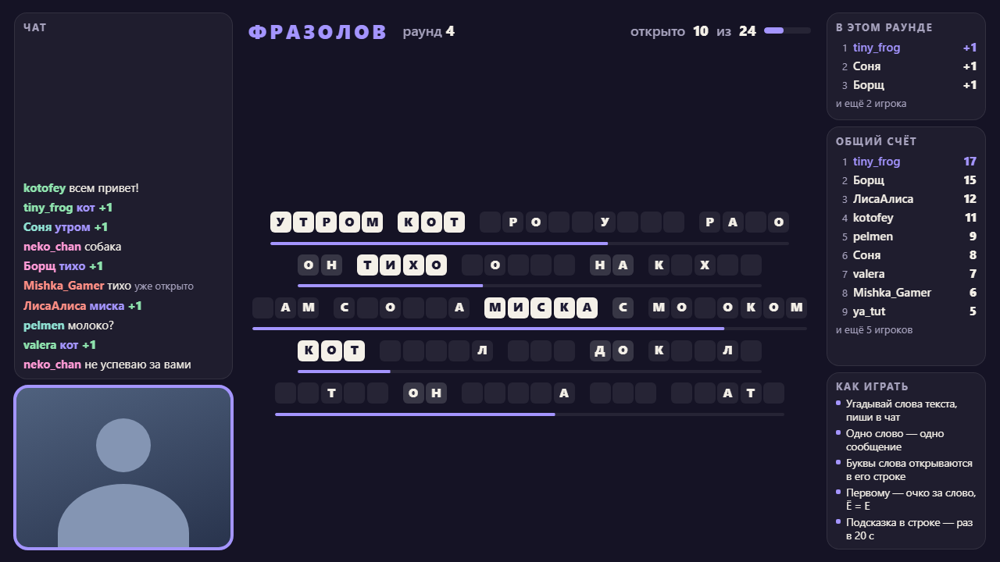
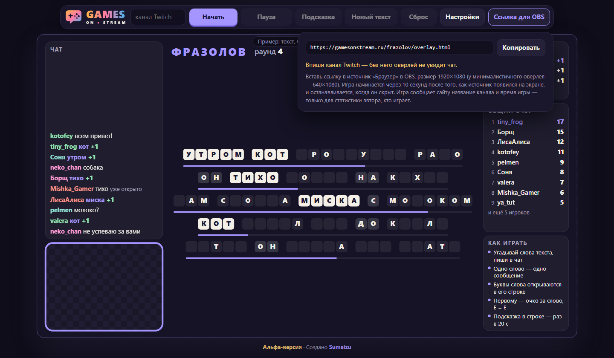
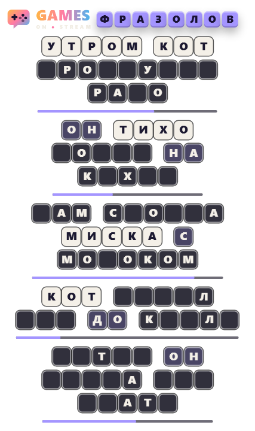

# Фразолов

Игра для чата Twitch на русском языке. На экране стрима загадан короткий текст из пяти предложений — видны
только клетки под буквы. Зрители пишут в чат слова, которые могут в нём быть. Угадал слово — оно открывается,
а его буквы загораются во всей своей строке и подсказывают остальные слова.

**Альфа-версия:** игра в разработке и ещё сырая.



**[gamesonstream.ru/frazolov](https://gamesonstream.ru/frazolov/)** — играй прямо в браузере или вставь ссылку в OBS.

Ставить ничего не нужно: ни программ, ни регистрации, ни ключей Twitch. Сервера у игры нет — она сама читает чат и
сама ведёт раунды прямо в браузере.

## Как запустить



**В браузере.** Открой [gamesonstream.ru/frazolov](https://gamesonstream.ru/frazolov/), впиши сверху свой канал
Twitch и нажми «Начать». Через 10 секунд пойдёт первый раунд, дальше раунды идут сами. Пока игра не начата, на её
месте пример с выдуманным текстом, чатом и счётом.

Рядом с «Начать» — ещё четыре кнопки. **«Пауза»** замораживает игру: вместо поля на экране счёт раунда и общий
счёт, а «Продолжить» возвращает раунд с того же места. **«Подсказка»** сразу открывает одну букву в одной из строк.
**«Новый текст»** заканчивает раунд и показывает текст целиком; на итогах — сразу начинает следующий раунд.
**«Сброс»** обнуляет общий счёт; чтобы не сбросить случайно, кнопку нужно нажать дважды.

**В OBS.** На той же странице нажми «Ссылка для OBS», скопируй ссылку и вставь её в источник «Браузер»: ширина
1920, высота 1080 (у минималистичного оверлея — 640×1080). Игра начнётся через 10 секунд после того, как источник
появился на экране.

Кнопка «Настройки» открывает панель рядом с игрой. Сохранять ничего не нужно: правки сразу действуют на игру в
браузере, а ссылка для OBS обновляется сама.

Что полезно знать про OBS:

- **Сцены.** Скрыл источник или ушёл на другую сцену — игра остановилась. Вернулся — новый отсчёт и новый текст.
  Можно ещё отметить в свойствах источника «Отключать источник, когда он не виден»: тогда OBS сам выключает игру
  вместе с источником.
- **Вебка.** Окошко под вебку прозрачное: источник с камерой поставь в OBS под оверлей и подгони под рамку.
  Окошко во всех играх Games on Stream стоит в одном месте — при смене игры камеру двигать не нужно. Для витуберов
  есть режим «Витубер»: окошко вертикальное, 420×540 в источнике 1920×1080, — туда помещается моделька из VTube
  Studio.
- **Звук** идёт из источника. Чтобы у игры была своя дорожка в микшере, включи в свойствах источника «Управление
  аудио через OBS».
- **Настройки зашиты в ссылку.** Поменял настройки — вставь в OBS новую ссылку.
- **Статистика.** Игра сообщает сайту название канала и время игры — только для статистики автора, кто играет.
- **Общий счёт хранится в OBS.** Нужна игра в нескольких сценах — добавляй тот же источник («Добавить
  существующий»), а не новый: два разных источника с одной ссылкой — это две игры сразу.
- **Обновления.** Оверлей сам замечает, что игра обновилась, и перезагружается между раундами.

## Правила

- Загадан короткий связный текст из пяти предложений — маленькая история из обычной жизни. Каждое предложение
  стоит на своей строке. Слова скрыты, видно только, сколько в каждом букв.
- Пиши в чат слова, которые могут быть в тексте: **одно сообщение — одно слово**. «Ё» и «е» — одна буква.
- Угадал слово — оно открывается, а **его буквы загораются во всей его строке**. В других строках буквы
  открываются отдельно. Слово, у которого видны все буквы, открывается само, без очков.
- Слово достаётся тому, кто написал его первым, — **одно слово, одно очко**. Слово, которое встречается
  в тексте несколько раз, открывается везде, а очко за него — одно.
- Слова из одной-двух букв («в», «не», «мы») открыты сразу. Если их букв в строке меньше двух, в начале раунда
  в ней загорается ещё случайная буква — или две.
- **Подсказки — у каждой строки свои.** Если в строке 20 секунд ничего не угадали, в ней открывается одна
  случайная буква. Сколько осталось до подсказки, показывает полоска под строкой.
- Раунд идёт, пока не открыт весь текст. Потом на экране итоги — кто сколько набрал, — и через 20 секунд
  загадывается следующий текст. Недавние тексты не повторяются.
- **Общий счёт** копится от раунда к раунду. Его обнуляет кнопка «Сброс», команда в чате или расписание из
  настроек.

## Команды в чате

Для стримера и модераторов:

```
!фразолов-раунд    закончить раунд; на итогах — сразу начать следующий
!фразолов-пауза    поставить игру на паузу; ещё раз — продолжить
!фразолов-сброс    обнулить общий счёт
```

На паузе игра замирает: слова не засчитываются, подсказки и отсчёты стоят, а вместо поля на экране — счёт раунда
слева и общий счёт справа. Команды работают и в браузере, и в OBS.

## Настройки

| Настройка | По умолчанию | Что делает |
| --- | --- | --- |
| Канал Twitch | — | Чей чат читать: логин или ссылка на канал |
| Минималистичный оверлей | нет | Вертикальный, 640×1080, без фона: логотип, название и текст |
| Подсказка | 20 с | Через сколько секунд без угаданных слов в строке в ней открывается буква. 0 — без подсказок |
| Пауза между раундами | 20 с | Сколько на экране висят итоги |
| Лимит времени на раунд | 0 | 0 — раунд идёт, пока не открыт весь текст |
| Команды для стримера и модераторов | включены | `!фразолов-раунд`, `!фразолов-пауза` и `!фразолов-сброс` |
| Сбрасывать общий счёт | только вручную | Или сам: каждый день, неделю, месяц — в заданный час — либо по таймеру |
| Звуки и громкость | включены, 100% | Отсчёт, начало раунда, угаданное слово, новые буквы, итоги |
| Окошко под вебку | с вебкой | «Без вебки» — место окошка занимает чат; «Витубер» — окошко вертикальное, чат над ним короче |

Значения по умолчанию — рекомендуемые: с ними страница открывается в первый раз, к ним же возвращает кнопка
«Рекомендуемые настройки».

Минималистичный оверлей — для стримов, где игра стоит сбоку от основной картинки.



## Что на экране

- **Текст** — в клетках, каждое предложение на своей строке, под строкой — полоска до подсказки. Размер клеток
  оверлей считает сам; в минималистичном оверлее длинные предложения переносятся.
- **Чат** показывает все сообщения зрителей, угаданные слова в нём подсвечены. Смайлики Twitch, 7TV, BetterTTV и
  FrankerFaceZ показываются картинками. Сообщения известных ботов в чат не попадают. Если модератор удалил
  сообщение или забанил зрителя, с экрана оно тоже пропадает.
- **Счёт.** Счёт раунда и общий счёт занимают весь столбик справа. Когда игроков больше, чем помещается, в общем
  счёте остаётся первая десятка, а остальное место достаётся раунду.
- **Автор игры в чате.** Ник разработчика (Sumaizu на Twitch) вшит в игру: если он заглянет на стрим, его ник будет
  переливаться радугой. Ещё у нескольких зрителей, которых отметил автор, свой цвет ника.

## Для разработчиков

Игра — статические страницы на чистом JavaScript: без сборки и без сторонних библиотек.

```
site/index.html        главная страница: игра в браузере, настройки, ссылка для OBS
site/overlay.html      оверлей
site/js/page.js        главная страница
site/js/overlay.js     запуск оверлея: сам по себе в OBS или внутри главной страницы
site/js/phrases.js     тексты и память о последних
site/js/engine.js      правила: раунды, очки, подсказки
site/js/chat.js        чтение чата Twitch без токена
site/js/config.js      настройки и их упаковка в ссылку
site/js/view.js        отрисовка оверлея
site/js/sound.js       звуки
site/js/emotes.js      смайлики 7TV, BetterTTV и FrankerFaceZ
site/js/demo.js        пример, который виден, пока игра не начата
tests/js/              тесты
tools/                 локальный сервер, запуск тестов, снимки для README
```

Запустить у себя — `site.bat` или `python tools/serve.py`: откроется `http://127.0.0.1:8774/`. Нужен Python 3.9
или новее.

Тесты идут в скрытом браузере (Edge или Chrome):

```
pip install websocket-client
python tools/jstest.py
```

Картинки для этой страницы снимает `python tools/shots.py`.

Сайт выкладывается на GitHub Pages сам: когда в ветку `main` приходят изменения в папке `site/`, она публикуется
целиком (`.github/workflows/pages.yml`).

## Лицензия

Играть на своих стримах можно свободно — в том числе на стримах с донатами, подписками и рекламой.

Код открыт только для некоммерческого использования — лицензия
[PolyForm Noncommercial 1.0.0](LICENSE.md). Его можно читать, копировать и менять для себя. Продавать игру, её копии
и переделки, брать плату за доступ к ним и зарабатывать на них любым другим способом без разрешения автора нельзя.
За разрешением — к автору: [twitch.tv/sumaizu](https://twitch.tv/sumaizu).
